<div align="center">

# NetMon

**Yerel Ağ Cihaz İzleme, Donanım Hata Takip ve Destek (Ticketing) Sistemi**

Kurumsal yerel ağdaki yazıcı, switch, sunucu ve bilgisayarları otomatik bulan, donanım arızalarını anlık yakalayan
ve bunları BT ekibinin takip ettiği destek biletlerine dönüştüren web tabanlı bir izleme platformu.


</div>

> **Not:** Bu depo projenin **tanıtım sayfasıdır**. Kaynak kod özel bir depoda tutulmaktadır.
> Ekran görüntüleri, gerçek ağ yerine projenin kendi **simülasyon modundan** (sanal yazıcı, switch ve bilgisayarlar) alınmıştır;
> bilgisayar ekranındaki donanım verisi gerçek bir ajan raporudur, cihaz adı ve ağ bilgileri değiştirilmiştir.

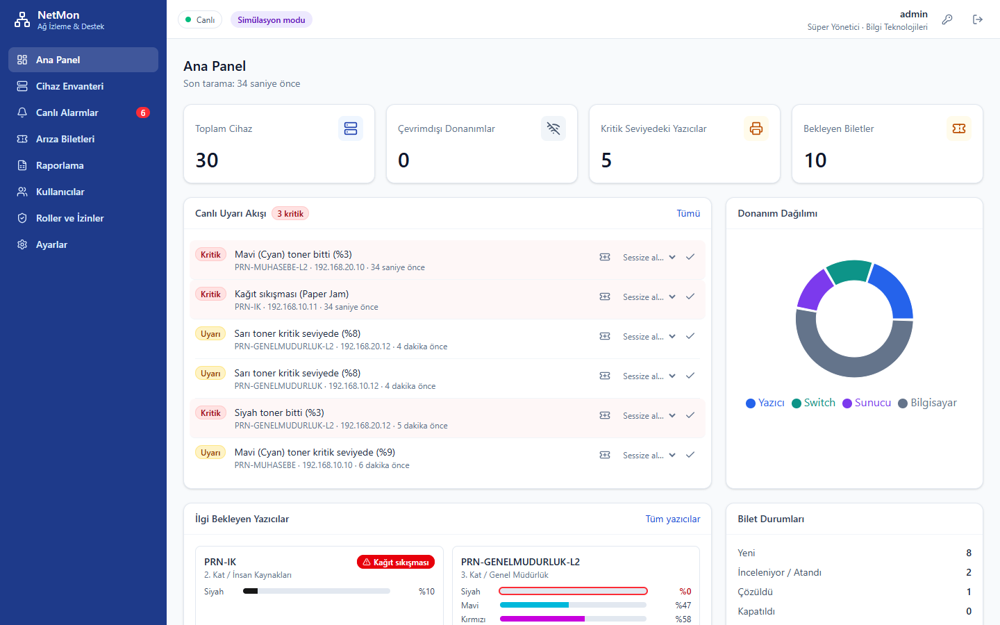

---

## Ne işe yarar?

Bir şirketin BT ekibi için üç sorunu tek ekranda çözer:

1. **Ağda ne var?** Belirlenen IP aralıklarını düzenli olarak tarar; cihazları SNMP ile tanıyıp **yazıcı / switch / sunucu / bilgisayar**
   olarak sınıflandırır, envantere ekler.
2. **Ne bozuldu?** Toner bitmesi, kağıt sıkışması, kapak açık kalması, kritik switch portunun kopması, işlemcinin aşırı ısınması,
   diskin dolması gibi durumları yakalar ve **anlık alarm** üretir.
3. **Kim ilgileniyor?** Kritik alarmlar **otomatik arıza bileti** açar; çalışanlar da kendi taleplerini oluşturur. Teknisyenler
   biletleri Kanban panosunda üstlenir, not ekler ve kapatır.

## Öne çıkan özellikler

| | |
|---|---|
| 🔎 **Otomatik keşif** | Ping + SNMP v1/v2c/v3 ile ağ taraması; sınırlı paralellikte arka plan motoru, MAC adresi ARP veya SNMP ile |
| 🖨️ **Yazıcı takibi** | Renk renk toner seviyesi, kağıt sıkışması / kağıt bitti / kapak açık (RFC 3805 Printer-MIB) |
| 🔌 **Switch port matrisi** | 48 portun anlık durumu; uplink/sunucu portları kritik olarak işaretlenir, koptuğunda alarm |
| 🌡️ **NetMon Ajanı** | Bilgisayarlara kurulan Windows servisi: CPU/GPU/disk **sıcaklıkları**, disk ömrü, pil yıpranması, RAM, sürücüler |
| ⚡ **Gerçek zamanlı** | SignalR ile alarmlar, cihaz durumları ve bilet değişiklikleri sayfa yenilemeden ekrana düşer |
| 🎫 **Destek biletleri** | Kanban + liste görünümü, atama, durum geçmişi ve notlar; kritik alarmdan otomatik bilet |
| 🔕 **Akıllı alarm** | Histerezis (eşik çevresinde açılıp kapanmayı önler), tekilleştirme, alarmı 1/7/30 gün sessize alma |
| 🛡️ **Rol ve izinler** | 13 ayrıntılı izin, 4 hazır rol + yöneticinin oluşturduğu **özel roller**; değişiklik açık oturumlara anında yansır |
| 📊 **Raporlama** | Biçimlendirilmiş Excel (.xlsx) raporu ve analiz için SQL veri dökümü |
| ⚙️ **Kolay kurulum** | Tek komutla Windows hizmeti olarak kurulum, ilk açılış sihirbazı, arayüzden tek tıkla ajan paketi indirme |

## Ekran görüntüleri

<table>
<tr>
<td width="50%"><b>Cihaz envanteri</b><br>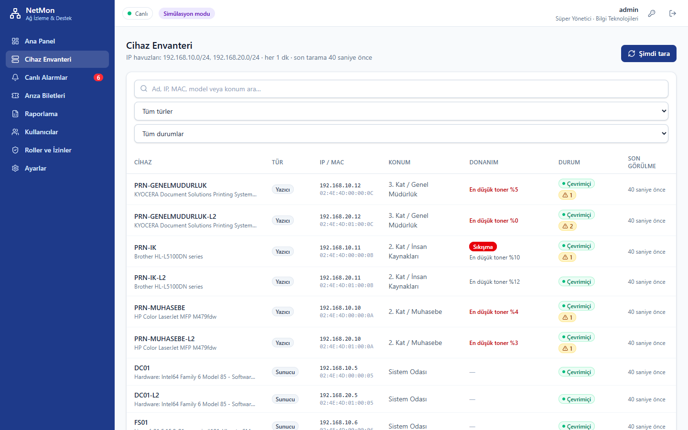</td>
<td width="50%"><b>Arıza ve destek biletleri (Kanban)</b><br>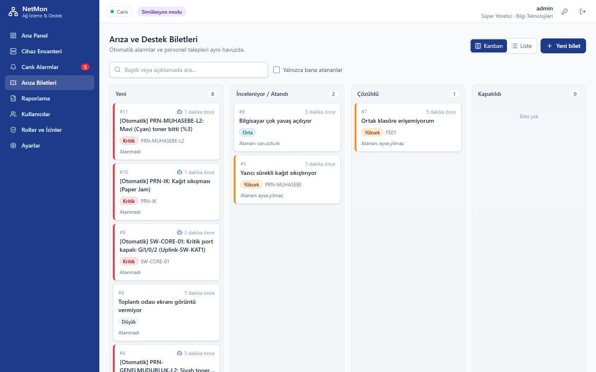</td>
</tr>
<tr>
<td><b>Yazıcı: toner ve kağıt yolu durumu</b><br>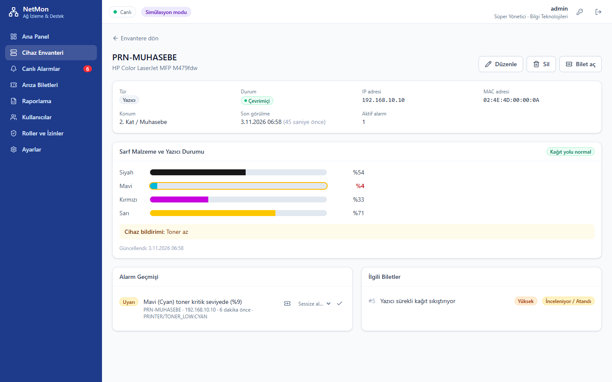</td>
<td><b>Switch: 48 portluk durum matrisi</b><br>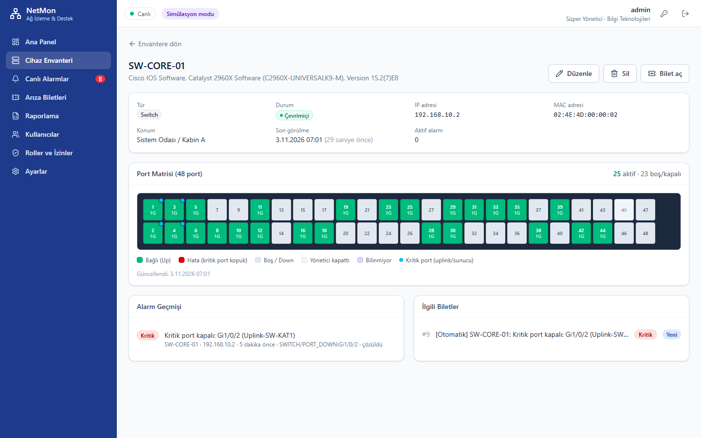</td>
</tr>
<tr>
<td><b>Bilgisayar: NetMon Ajanı donanım verisi</b><br>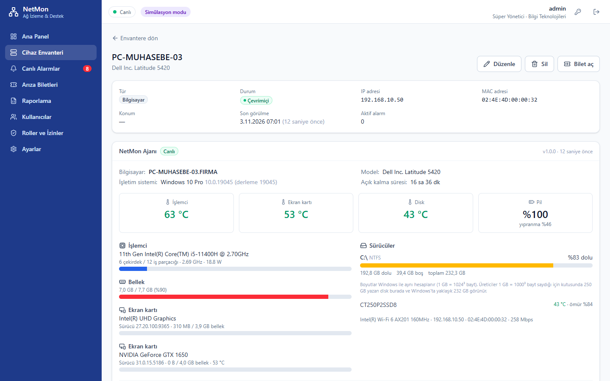</td>
<td><b>Canlı alarmlar</b><br>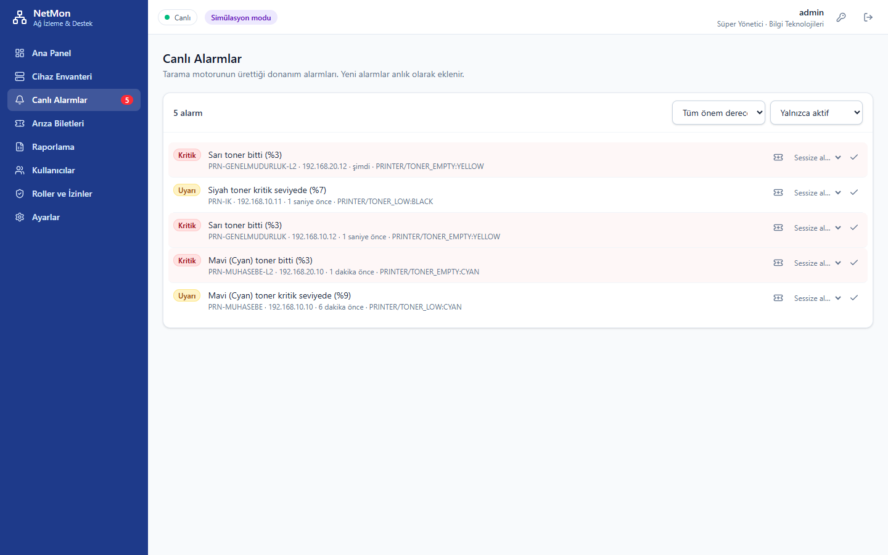</td>
</tr>
<tr>
<td><b>Roller ve izinler (özel rol)</b><br>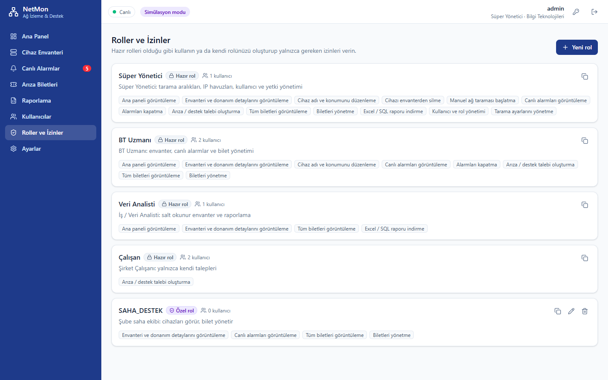</td>
<td><b>Ayarlar: eşik değerleri</b><br>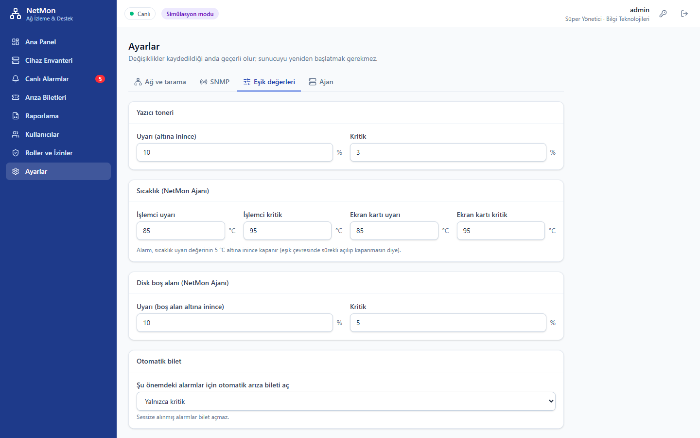</td>
</tr>
<tr>
<td><b>Raporlama</b><br>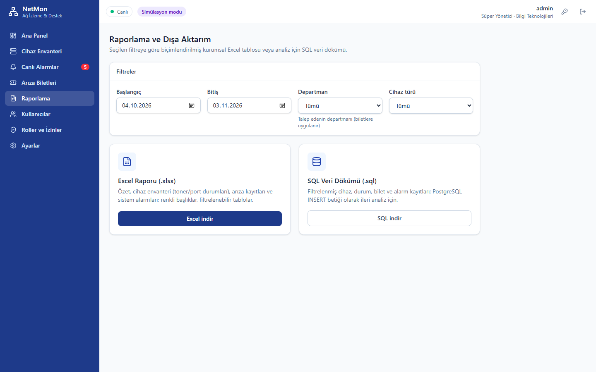</td>
<td><b>Giriş</b><br></td>
</tr>
</table>

## Mimari

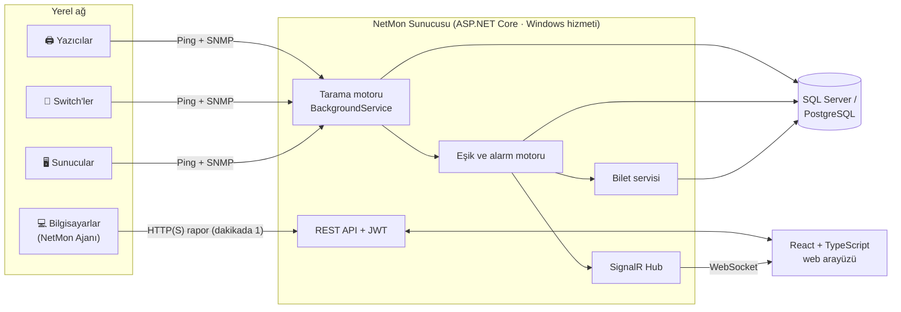

Backend **Clean Architecture** ile katmanlara ayrılmıştır:

```
NetMon.Domain          Varlıklar, enum'lar, izin kataloğu, bilet iş akışı kuralları
NetMon.Application     Tarama, cihaz sınıflandırma, eşik/alarm motoru, bilet, rapor ve kullanıcı servisleri
NetMon.Infrastructure  EF Core (SQL Server + PostgreSQL), SNMP istemcisi, ARP/ping, Excel, JWT, simülatör
NetMon.Api             Controller'lar, SignalR hub, arka plan işçisi, Windows hizmeti barındırma
NetMon.Agent           Bilgisayarlara kurulan tek dosyalık donanım ajanı (LibreHardwareMonitor + WMI)
web/                   React 19 + TypeScript + Vite + Tailwind CSS 4 arayüzü
```

## Teknolojiler

| Katman | Kullanılanlar |
|---|---|
| Backend | C#, ASP.NET Core Web API, Entity Framework Core, BackgroundService, Windows Service |
| Ağ / donanım | SharpSnmpLib (SNMP v1/v2c/v3 · SHA-2/AES), Printer-MIB, IF-MIB, BRIDGE-MIB, Host Resources MIB, ARP |
| Ajan | .NET tek dosya yayın, LibreHardwareMonitor, WMI, imzalı PawnIO sürücüsü |
| Gerçek zamanlı | SignalR (izin bazlı gruplar) |
| Güvenlik | JWT, BCrypt, izin tabanlı yetkilendirme, giriş hız sınırı, zorunlu ilk şifre değişimi |
| Raporlama | ClosedXML (Excel), veritabanı lehçesine göre SQL dökümü |
| Frontend | React 19, TypeScript, Vite, Tailwind CSS 4, TanStack Query, Recharts, dnd-kit |
| Veritabanı | SQL Server veya PostgreSQL (aynı şema, iki lehçe) |
| Test | xUnit (82 test; SNMP istemcisi gerçek UDP üzerinden sahte ajanla), Vitest |

## Mühendislik notları

- **Standartlara sadık okuma:** Yazıcı hata bitleri, şartnamedeki tablo yerine RFC 3805/2790'daki gerçek bit sırasına göre çözülür;
  kağıt sıkışması ayrıca `prtAlertTable` ile doğrulanır.
- **Cihaz sınıflandırma:** Printer-MIB, bilinen ağ işletim sistemi imzaları ve BRIDGE-MIB'e dayanan, birim testli bir karar
  kuralı; Windows'un yazıcı kuyruklarını yayınlaması gibi yanıltıcı durumlar ayıklanır.
- **Kopya kayıt yok:** IP'si değişen (DHCP) cihaz MAC adresiyle eşleşir, mevcut kaydı günceller.
- **Gürültüsüz alarmlar:** Edge-triggered alarm üretimi, histerezis (toner %10'da açılır, %15'te kapanır; sıcaklıkta 5 °C tolerans),
  ardışık taramada yanıt vermeyen cihaz için çevrimdışı onayı.
- **Canlı ayarlar:** Ayarlar sayfasındaki değişiklikler sunucu yeniden başlatılmadan geçerli olur.
- **Güvenli varsayılanlar:** Uygulama üretimde geliştirme anahtarları, simülasyon modu veya örnek şifreyle açılmayı reddeder.
- **Simülatör:** Gerçek OID'lerle yanıt veren sanal bir LAN (switch, yazıcı, sunucu, bilgisayar); toner zamanla azalır,
  rastgele sıkışma ve port kopmaları olur. Geliştirme ve demo bu sayede donanım gerektirmez.

## Kapsam

- ~7.600 satır C# · ~4.600 satır TypeScript/React · SQL Server ve PostgreSQL şemaları
- 100+ otomatik test (backend + arayüz)
- Tek komutla kurulum betiği, Windows hizmeti, güvenlik duvarı kuralı ve ajan dağıtım paketi

---

<div align="center">

Kaynak kod özeldir. Proje hakkında bilgi veya canlı demo için benimle iletişime geçebilirsiniz.

</div>
